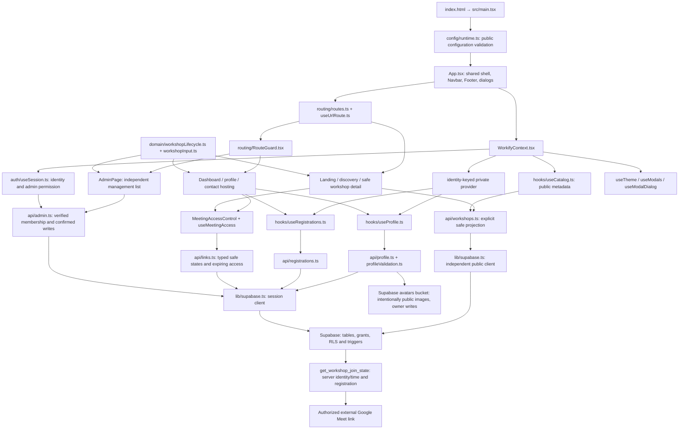

# Workify: reviewed source architecture

Prompt 14, 23 October 2026. This describes the local implementation, not an
assertion that the inspected cloud database or an unknown deployed frontend has
these contracts. The release review records the observed differences.

The public detail page can display the shared meeting control, but it fetches
protected access only for an authenticated registered user. Workshop metadata
queries do not include the URL. Meeting access does not call an assessment system.
No active review/assessment function branch exists in this architecture.

`useResource` owns read timeout, abort, latest-request-wins and explicit error /
refresh states. Mutation owners reconcile shared snapshots after a result; they
do not infer success from a click or an empty affected-row response. A new account
gets a fresh private provider and feature tree; the safe public catalog, theme
and URL can persist. Client lifecycle/route checks explain actions; server grants,
ownership, validation and server time authorize them.

The canonical application is the repository root with `src/`, `public/`, one
lockfile and one Vite build. `frontend/` is retired. The `.review-stage05/`
historical local snapshot is ignored and preserved. Tailwind source detection
is explicitly restricted to `src/` and root `index.html`, so prompt documents,
tests and old snapshots cannot change production CSS.

`backend/supabase/migrations/` contains historical and pending SQL sources.
`tests/database/integration.test.mjs` applies the combined contracts only in a
disposable PGlite instance with minimal auth/storage fixtures. Browser fixtures
are test-only entry points and are excluded from production output by the Vite
module boundary. Neither test setup creates a production session or bypass.

Historical review rows remain in `linkedin_reviews`; archival preserves them.
The exact retired workshop stays archived in the local contract. A future
assessment or approved-host self-service product requires a separate decision.
Google sign-in remains removed and no replacement authentication was introduced.
